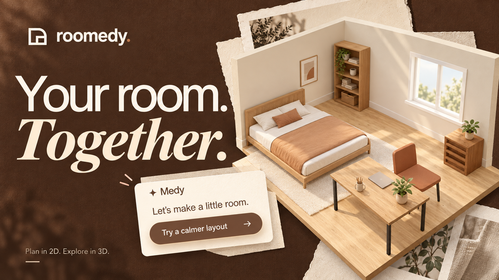

<h1 align="center">Roomedy</h1>

<p align="center">
  <strong>Your room, made real.</strong>
</p>

<p align="center">
  <a href="https://roomedy-frontend-860563209111.europe-west1.run.app"><strong>Try the demo</strong></a>
  · <a href="#why-roomedy">Why Roomedy</a>
  · <a href="#medy-beside-you">Meet Medy</a>
  · <a href="#run-locally">Run locally</a>
</p>

<p align="center">
  
</p>

A room you know. A design you can explore. A plan you can take with you.

Roomedy brings your room into an editable 2D and 3D studio. Try a different layout, find a finish you love, see the room by day or night, and bring your furniture choices and estimated costs together—with **Medy** beside you through the design and shopping conversations.

Start with a few photos, explore the example room, or build a room from scratch.

## Why Roomedy

| See the possibilities | Make it yours | Bring it together |
| --- | --- | --- |
| Explore your layout in 2D and 3D before moving the furniture. Compare arrangements, materials and lighting in one studio. | Shape the colours, textures and details—from walls and floors to furniture, bedding, mirrors and light fixtures. | Find products for the room, review the estimated costs and take away a visual PDF with your design and selected pieces. |

## From your room to your plan

1. **Bring the room into view** — add photos, use the supplied examples, or choose a manual starting point.
2. **Explore a new direction** — arrange furniture, try materials and colours, and switch between day and night.
3. **Choose the pieces** — compare furniture, flooring and wall paint options. Pick your favourites or ask Medy to choose from the results.
4. **Take the plan with you** — review the selected products and costs, save an estimate, and export a PDF with room views, finishes and shopping details.

## Medy, beside you

“Make the work area walnut.” “Find flooring options.” “Choose for me.”

Medy works with the room you're designing. Ask for an idea, explore a finish or request a supported change. Review the preview before **Apply**, and use **Undo** to reverse an accepted edit.

In Estimate, the conversation connects to product cards, quantities and source links. Choose for yourself or hand the selection to Medy, then review the pieces together in a visual summary. The explanation stays with the visuals, so you can see what to compare and how to interact with it.

## Made for the whole picture

- **One room, two perspectives:** a detailed 2D plan and an interactive 3D view share the same design.
- **Details that change the feel:** explore room themes, individual finishes, bedding, mirrors and lighting without starting over.
- **Your choices stay connected:** selected products feed the estimate, with quantities, recorded prices and sources available to review.
- **A presentation to take away:** the PDF leads with your room—large views, plans and finishes—then brings in products and costs.
- **Room to come back:** Continue saved room restores your design and both conversations in the same tab during the two-hour session. Editable project exports let you keep the room separately.

## Run locally

Use **Node 24.19.0** and **pnpm 11.25.0**.

```sh
pnpm install --frozen-lockfile
pnpm build:shared
```

Start the backend and frontend in separate terminals:

```sh
pnpm dev:backend
```

```sh
pnpm dev:frontend
```

Open [Roomedy on port 4320](http://127.0.0.1:4320).

Local defaults use fake AI with paid operations off. The manual studio needs no provider key; protected API operations require matching bridge configuration. The [frontend](apps/frontend/README.md) and [backend](apps/backend/README.md) guides cover setup and optional live configuration. Committed environment examples contain blank secrets; local configuration stays ignored.

Run the repository checks with `pnpm check`.

## Explore the project

Built with **Next.js, React, Three.js, Express and TypeScript**, with shared room and estimate rules behind the experience.

- [Product and visual overview](docs/ROOMEDY_OVERVIEW.html)
- [Documentation and architecture](docs/README.md)
- [Frontend guide](apps/frontend/README.md) · [Backend guide](apps/backend/README.md)
- [Release status and preparation](docs/operations/DEPLOYMENT_PREPARATION_HANDOFF.md)

Roomedy is a portfolio demo for rectangular bedrooms and workspaces. Photo layouts are planning illustrations; confirm measurements, product fit, quantities and supplier terms before buying or carrying out work. This README describes the current source; the hosted demo may run an earlier revision.

<p align="center">
  Built and maintained by <a href="https://github.com/minatamer">Mina Tamer</a>.
</p>
